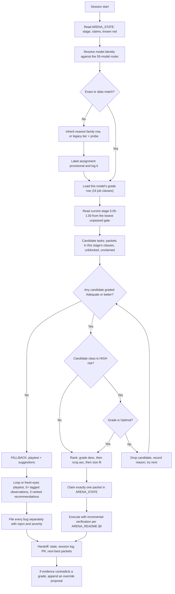

# ARENA MODEL ROUTER — per-model task assignment for The Violence

> **Canonical entry point: [`ARENA.md`](ARENA.md).** That single file holds the routing
> algorithm, the stage/class/model tables, the evidence layer, the writing lane, and the
> Godot / verification / playtest / state / git rules — all specific to The Violence.
> The document below is the full per-model routing expansion pack: load it when
> `ARENA.md` §L15 says to.

**Supersedes the tier-band routing in [`ARENA_README.md`](ARENA_README.md) §1 and §4.**
Everything else in that document — the hard rules, work packets, the task ladder, the
verification ladder, playtesting protocol and handoff protocol — still applies and is
referenced here rather than restated.

| Field | Value |
|---|---|
| Routing inputs | (1) **specific model identity** — one of 55 measured models · (2) **tasks available at the current roadmap stage** |
| Roadmap resolution | 20 stages, `0.05 … 1.00` in `0.05` steps ([§3](#3-the-20-stage-roadmap-increment-model)) |
| Capability scale | per **job class**, four grades: **Optimal / Competent / Adequate / Inadequate** ([§4](#4-the-four-capability-grades)) |
| Default lane | playtesting + suggestions when nothing in the stage rates ≥ Adequate ([§7](#7-the-fallback-lane-playtesting--suggestions)) |
| Data snapshot | Arena.ai Agent Arena, **2026-10-23**, 55 models, 2,557,423 sessions (`docs/arena/leaderboard_2026-10-23.csv`) |
| Implementation | `tools/arena_router.py` (this document is the spec; the script is the reference implementation and both are tested against each other) |
| Owner | Repo maintainers; only models graded **Optimal** for `STRUCT` may edit this file |

> **The one-sentence version.** We stopped asking "how good is this model overall" and
> started asking "is *this specific model* the right one for *this specific job*, at
> *this point* in the roadmap" — and gave every model that answers "no" a real job.

---

## Table of contents

- [0. What changed and what did not](#0-what-changed-and-what-did-not)
- [1. The two routing inputs](#1-the-two-routing-inputs)
- [2. Identity resolution](#2-identity-resolution)
- [3. The 20-stage roadmap increment model](#3-the-20-stage-roadmap-increment-model)
- [4. The four capability grades](#4-the-four-capability-grades)
- [5. The routing flowchart](#5-the-routing-flowchart)
- [6. Routing rules](#6-routing-rules)
- [7. The fallback lane: playtesting + suggestions](#7-the-fallback-lane-playtesting--suggestions)
- [8. Dispatch table (all 55 models)](#8-dispatch-table-all-55-models)
- [9. Worked examples](#9-worked-examples)
- [10. Maintenance: keeping the router honest](#10-maintenance-keeping-the-router-honest)
- [11. Research base and its limits](#11-research-base-and-its-limits)
- [12. External validation (25 October 2026)](#12-external-validation-25-october-2026)
- [13. Creative writing has a second axis](#13-creative-writing-has-a-second-axis)

---

## 0. What changed and what did not

**Changed.** Routing used to be four tiers keyed to leaderboard bands (`#1–11`, `#12–25`,
`#26–40`, `#41–55`). That treated eleven very different models as interchangeable and threw
away the most predictive thing we have: each model's *own* signal profile. A model ranked
#16 can be the best available choice for cheap asset iteration and a poor choice for a
save migration; a model ranked #9 can be superb at long refactors and mediocre at
narrative. Tier bands cannot express that. Per-model grading can.

**Not changed, and not negotiable.**

- The **twelve hard rules** in `ARENA_README.md` §0.3.
- **Work packets** (`§6`) — every assignment is a packet with scope, acceptance criteria and
  a verification method. The router chooses *who*; the packet defines *what*.
- The **task ladder** (`§7`) — rungs 1–6 still order priority. The router ranks within the
  tasks that survive the ladder.
- The **verification ladder** (`§9`) — v0…v5, and the rule that unverified work is labeled
  unverified.
- The **handoff protocol** (`§13`) and **playtesting protocol** (`§10`).

**Tiers now exist only as a fallback** for a model that cannot be identified at all
(§2.4). A recognized model is never routed by tier.

---

## 0.5 The Violence: stage-to-milestone mapping

The 20 generic stages (§3) map to The Violence's five milestones
(`Arena Protocols/ROADMAP.md`). The game currently sits at **stage 10 (0.50)** —
the vertical slice gate. Forward progress traverses stages 11–20 toward release.

| Stage | Progress | Milestone | The Violence: specific gate evidence |
|---|---|---|---|
| 10 | 0.50 | **Current** | Fresh-eyes playtest reaches election unaided; S0/S1 list empty. **Status: met.** 12 maps, 40-week campaign, 36 harnesses, deterministic sim. Labeled v0.50. |
| 11 | 0.55 | M1 Foundation | `tools/run_tests.sh --soak` green on multi-core; all 11 balance matrix cells filled; 18 silent harnesses given exit codes; CI activated and green on both engines |
| 12 | 0.60 | M2 Production | LICENSE + THIRD_PARTY_NOTICES committed; repo root clean (no noir prose files); Windows exe rebuilt from current source, verified, and tested on real hardware |
| 13 | 0.65 | M3 Experience (early) | Score composed and integrated (title theme + at least 2 ambient beds); onboarding audit completed with 3+ fresh-eyes playtests; top-5 confusion points addressed |
| 14 | 0.70 | M3 Experience (late) | Font scaling, key rebinding, reduced-motion toggle all verified; Q1/Q6/Q3 debrief visibility lines added; all 14 shorts wired or formally excluded |
| 15 | 0.75 | M4 Depth (early) | `tr()` infrastructure in place; at least one non-English language proofed; performance budget asserted on m11_plaza; 30-min memory soak clean |
| 16 | 0.80 | M4 Depth (late) | 5 full 40-week campaigns logged with all 3 endings reachable; endless battle 30-min soak clean; store assets (screenshots, trailer, description) ready |
| 17 | 0.85 | M5 Release (early) | Every open bug report has severity, repro, and owner; balance regression suite runs weekly; no S0/S1 open |
| 18 | 0.90 | M5 Release (mid) | Frame/memory budgets met over 30-minute soak on target hardware; save migration from v0.50 tested; code signing or storefront distribution confirmed |
| 19 | 0.95 | M5 Release (late) | Release notes written; platform submission complete; crash-log path documented for players; post-release bug path exists |
| 20 | 1.00 | **Ship** | Version bumped to 1.0.0; tagged; published through at least one channel; final playtest logged |

**Routing implication:** Models graded Optimal at `TOOL` are most needed at stages 11–12
(test infrastructure, CI, build scripts). Models graded Optimal at `ASSETS`/`AUDIO`
are most needed at stages 13–14 (score, accessibility assets). Models graded Optimal
at `SYS`/`PERF` are most needed at stages 15–16 (localization, performance). Models
graded Optimal at `STRUCT`/`DOCS` are most needed at stages 17–20 (release mechanics).

**The Violence's class priority by milestone:**

| Milestone | Primary classes (in order) | Why |
|---|---|---|
| M1 Foundation | TOOL → SYS → QA → DEBUG | Test infra must be trustworthy before anything else |
| M2 Production | STRUCT → TOOL → SYS → UIUX | Legal, distribution, repo cleanup, Windows build |
| M3 Experience | AUDIO → ASSETS → UIUX → SYS → NARR | Score, accessibility, onboarding polish |
| M4 Depth | SYS → PERF → TOOL → NARR → QA | Localization, performance, extended testing |
| M5 Release | DOCS → STRUCT → TOOL → QA → MIGR | Release notes, submission, post-release path |

---

## 1. The two routing inputs

The router is a pure function of two things, evaluated once per session:

```
assignment = route(model_identity, available_tasks(current_stage))
```

**Input 1 — specific model identity.** Not a tier, not a family: the exact entry in the
55-model roster, which carries a full grade row across 16 job classes.

**Input 2 — available immediate tasks.** The set of *unblocked, unclaimed* packets belonging
to the current stage's allowed job classes, each tagged with a class, a rung and a size. If
this set is empty or nothing in it reaches Adequate for this model, the session is not
wasted: it is routed to the fallback lane (§7), which is always available and always
productive.

Everything else — how long the model can run, how much it costs, how fresh its data is —
is already encoded in its grade row and does not need separate handling.

---

## 2. Identity resolution

### 2.1 Resolve exactly

1. Match the session's model string against the roster, case-insensitively.
2. Accept the board's parenthesised effort suffix as part of the identity
   (`(Max)`, `(High)`, `(xHigh)` are *different roster entries* with different scores —
   never collapse them).
3. Accept documented aliases: hyphens/underscores/versions written spacers-first
   (`claude-opus-5.5-max` → `Claude Opus 5.5 (Max)`), and the lab prefix
   (`anthropic/claude-sonnet-5-5` → `Claude Sonnet 5.5 (Max)`).
4. Prefer an exact match; if the name is ambiguous (`Claude Opus 5` vs `Claude Opus 5 (Max)`),
   **ask which one** rather than guessing — they differ by several grade steps.

### 2.2 Read the grade row

Emit, at the top of your first deliverable and in `ARENA_STATE.md`:

```
MODEL: Claude Haiku 5.5 (High) · #27 · stage 12 (0.60 Content scale-up)
GRADES: ARCH Adequate · SYS Adequate · DEBUG Adequate · MIGR Inadequate · TOOL Adequate ·
        PERF Inadequate · FEEL Inadequate · UIUX Inadequate · ASSETX Inadequate ·
        ASSETS Competent · NARR Inadequate · DOCS Inadequate · STRUCT Inadequate ·
        QA Competent · BUGREP Inadequate · AUDIO Inadequate
ASSIGNED: ASSETS (Competent) — icon set packet
```

Publish the grade row and the assignment. Do **not** publish commentary about your own
quality beyond it; the row is the auditable fact.

### 2.3 Unknown models

A model released after the snapshot will not match. Handle it in this order:

1. **Same family, same effort** in the roster → use that row, mark `inherited`, and file a
   roster-refresh packet. (Newer sibling is usually ≥ its predecessor; do not assume.)
2. **Different family, new model** → route using the parent lab's best-graded entry as a
   *ceiling* and the field median as a floor, and label the assignment `provisional`.
3. **No basis at all** → fall back to the legacy tier bands from `ARENA_README.md` §1, run
   the §1.4 capability probe there, and cap the session at tasks the probe demonstrated.

Provisional and inherited assignments must be re-checked at the next roster refresh; their
observed outcomes are exactly the evidence used to grade the model properly later (§10.3).

### 2.4 Never self-promote

You may not raise your own grade, and you may not accept an assignment above your grade
because the work is interesting. Two exceptions, both narrow and both logged:

- **Recorded override** from `ARENA_STATE.md` evidence (e.g. "this model completed three
  MIGR packets cleanly; promote to Competent") — the router accepts `--override CLASS=Grade`.
- **Exploratory probe** on a rung-6 packet, explicitly labeled, with the failure plan
  written before starting.

---

## 3. The 20-stage roadmap increment model

Every milestone is divided into **20 stages** of `0.05` progress. `1.00` is "milestone
complete", not "game shipped" — a project may have several milestones, each traversing
0.05→1.00.

Each stage declares **which job classes are in play** and **what evidence advances it**.
That is what makes routing adaptive: the same model is sent to different work at 0.15 than
at 0.95, and a model whose grades cluster in `ASSETS` is genuinely busy at 0.45 and 0.60
but mostly idle at 0.20 and 0.95 — where it correctly falls to playtesting.

| Stage | Progress | Name | Phase | Job classes in play (priority order) | Advance gate (evidence) |
|---|---|---|---|---|---|
| 1 | 0.05 | Bootstrap & repo truth | prototype | STRUCT, DOCS, TOOL, QA | Repo imports clean; `ROADMAP.md` + `ARENA_STATE.md` accurate |
| 2 | 0.10 | Core loop decision | prototype | ARCH, STRUCT, NARR | Core loop written down; one ADR; no code predicated on the opposite |
| 3 | 0.15 | Playable skeleton | prototype | SYS, ARCH, ASSETS, DEBUG | Main scene boots; one player verb works end to end |
| 4 | 0.20 | First full loop | prototype | SYS, DEBUG, FEEL | Start → fail/win without developer intervention |
| 5 | 0.25 | Data-driven foundations | prototype | ARCH, SYS, TOOL | Tunables live in `res://data/`, loaded through typed resources |
| 6 | 0.30 | Feel pass 1 | prototype | FEEL, QA, DEBUG | A loop playtest produces no "feels laggy/unfair" note |
| 7 | 0.35 | Slice scope lock | slice | STRUCT, NARR | Slice content list frozen and packet-ised |
| 8 | 0.40 | Slice systems complete | slice | SYS, UIUX, DEBUG | Every slice system works with placeholder content |
| 9 | 0.45 | Slice content pass | slice | ASSETS, ASSETX, NARR | No beat of the slice is placeholder-only |
| 10 | 0.50 | Vertical slice gate | slice | QA, BUGREP, DOCS, STRUCT | Fresh-eyes playtest reaches the end unaided; S0/S1 list empty |
| 11 | 0.55 | Production pipeline | production | TOOL, ARCH, ASSETS | A new asset/system can be added by documented, repeatable steps |
| 12 | 0.60 | Content scale-up | production | ASSETS, NARR, SYS | Content count tracks the milestone table |
| 13 | 0.65 | Narrative volume | production | NARR, DOCS, UIUX | All shipped content written, canon-consistent, `tr()`-ready |
| 14 | 0.70 | Systems hardening | production | DEBUG, PERF, MIGR | No known S1; perf in budget; saves round-trip |
| 15 | 0.75 | Feature complete | polish | FEEL, UIUX, QA | Feature freeze declared; tuning signed off by playtest |
| 16 | 0.80 | Polish & accessibility | polish | UIUX, FEEL, AUDIO | Contrast, focus nav, subtitles, UI scale verified |
| 17 | 0.85 | Bug triage sweep | polish | BUGREP, DEBUG, QA | Every open report has severity, repro and owner |
| 18 | 0.90 | Performance & memory | hardening | PERF, DEBUG | Frame/memory budgets met over a 30-minute soak |
| 19 | 0.95 | Release hardening | hardening | MIGR, DOCS, TOOL, QA, STRUCT | Migration tested on old saves; CI build reproducible |
| 20 | 1.00 | Ship | release | MIGR, DOCS, TOOL, QA, STRUCT | Release checklist complete; final playtest logged; tags cut |

**Setting the stage.** Record it in `ARENA_STATE.md` as `stage: N (0.XX)` with one line of
evidence. Compute it from the **lowest** unpassed gate, never from optimism or elapsed time.
If two gates disagree, the earlier one wins.

**Advancing the stage** requires the gate's evidence, recorded in the state file and, where
the gate is behavioral, a `PLAYTEST_LOG.md` entry. A stage may not advance on a claim
alone. Regression is allowed and normal: if a later gate fails, move back and say so.

**Job classes.** Full definitions, weights and confidence live in `tools/arena_router.py`
(`CLASSES`) and are summarized in §4.3.

---

## 4. The four capability grades

### 4.1 What each grade licenses

Grades are **per model, per job class**. "Optimal at DEBUG" says nothing about ASSETS.

| Grade | Meaning | What the router lets you do | Verification expected |
|---|---|---|---|
| **Optimal** | Top of the field for this job — the model we would wait for | Own the class end to end, including high-risk variants: architecture, migrations, structural roadmap/README edits | v2+v3 minimum, v4 for anything player-facing; before/after evidence for subjective calls |
| **Competent** | Solid, reliable, needs no supervision on a well-written packet | Own a standard packet in the class; may **not** take high-risk variants | v2+v3; v4 where the class is felt by the player |
| **Adequate** | Can do it with a tight packet and a defined exit | Take a packet that is narrow, pre-specified and cheap to verify; pair with a Competent+ review for anything shared | v1+v2, plus a review note from a higher grader |
| **Inadequate** | Do not route this job here | Nothing in this class. Go to the fallback lane | — |

### 4.2 How grades are computed

For each `(model, job class)` pair:

1. **Feature extraction.** Eleven features per model: overall/Code/Chat/Work rank, and
   within-field percentiles for confirmed success, praise-vs-complaint, steerability, shell
   reliability, tool hallucination, cost per task and wall-clock per task. Percentiles are
   used instead of raw magnitudes because the published percentages live on wildly
   different scales and a single outlier flattens a whole column. A percentile of `0.5`
   always means "the median model in the field".
2. **Fitness score.** A weighted blend of those features, with weights chosen per job class:
   narrative leans on Chat and praise, tooling on shell reliability and tool hallucination,
   cheap asset work on cost and wall-clock, migrations on completion and steerability.
3. **Percentile banding.** Within each class, models are sorted by fitness and graded by
   position in the 55-model field: **Optimal ≥ 90th percentile (top ~6)**, **Competent ≥ 65th
   (~14)**, **Adequate ≥ 25th (~22)**, **Inadequate below**. Grades are therefore *relative to
   the field*: they answer "who should we spend this job on", not "is this model good in the
   abstract". A compressed class still has a top.
4. **Hard gates** (applied after banding, and they can only lower a grade):
   - tool hallucination ≥ 5 points worse than field average → **Inadequate** for
     TOOL/DEBUG/MIGR/SYS/ARCH/STRUCT; ≥ 2 points worse → capped at Adequate for those classes;
   - shell reliability below the field average → capped at Adequate for TOOL/DEBUG;
   - steerability below the field average → capped at Competent for ARCH/STRUCT;
   - cost > $5/task → capped at Adequate for ASSETS/QA.
5. **Floors.** `QA` and `BUGREP` are floored at **Adequate**: every measured model can
   playtest and can write a bug report. Nobody is left with no work.

### 4.3 Class confidence — the honest caveat

| Class | Confidence | Why |
|---|---|---|
| ARCH, SYS, DEBUG, MIGR, TOOL, PERF | **high** | Code Arena and the tool signals measure these directly |
| FEEL, UIUX, NARR, DOCS | **medium** | Chat/Work categories and praise signals are proxies for taste and prose |
| ASSETX, ASSETS, AUDIO | **low** | The Agent board carries **no** signal for visual or audio quality |

Low-confidence grades are marked `*` in every generated table and are **priors, not
verdicts**. When the session log contradicts a low-confidence grade twice, the log wins
(§10.3). Do not let a low-confidence grade block a model from art or audio work that it
demonstrably does well; do not let it license a large asset budget on the first attempt
either — start with one deliverable, inspect it, then scale.

---

## 5. The routing flowchart

Evaluated fresh every session. Humans own this diagram; only an `Optimal`-at-`STRUCT` model
may propose a change to it, with an ADR.



### 5.1 Fill order within a stage

When several models are available in the same session window, fill by **constraint, not by
rank**: the most *specialized* viable assignment is claimed first, because it has the
fewest substitutes.

1. High-risk classes (ARCH, MIGR, STRUCT) — only Optimal graders, so the pool is smallest.
2. Narrow classes with few Optimal graders (PERF, DEBUG, TOOL).
3. Broad classes (SYS, DOCS, UIUX, NARR, ASSETS).
4. QA/BUGREP — always available, so claimed last by the model that has nothing else.

### 5.2 Splitting one packet across graders

A packet may be split only along a **review seam**, never along an implementation seam:

- Optimal model writes the design + acceptance criteria; Adequate model executes against
  them; the Optimal model reviews the diff — from a **different model family** wherever the
  roster allows (§6 rule 9). This is allowed and useful.
- Two models editing the same file in parallel is not allowed, regardless of grades.

---

## 6. Routing rules

1. **Grade, not reputation.** An Inadequate grade is a routing fact, not an insult, and not
   a suggestion you may overrule because you feel capable. Appeal by producing evidence in
   the session log, not by ignoring the row.
2. **One packet per session** (`ARENA_README.md` §2). Exception: two same-class packets under
   ~15 minutes each, declared up front.
3. **High-risk classes require Optimal** — architecture, save/data migration, and structural
   roadmap/README/design change. A Competent grader may *draft* a migration plan; it may not
   ship one.
4. **Stage decides availability.** A packet whose class is not in the current stage's list is
   not available, however good the model is at it. (This is what keeps a strong `NARR` model
   from writing lore at stage 0.20 while the core loop does not run.)
5. **The rung ladder still gates priority** (`ARENA_README.md` §7): a rung-1 blocker anywhere
   in scope outranks a rung-2 packet, even if the model is better suited to the latter — but
   only if that model is ≥ Adequate at the blocker's class. Otherwise the blocker is
   *reported* and the model takes what it can do.
6. **`Inadequate` never means idle.** It means "fallback lane now, and a bug report /
   suggestion if you found something".
7. **Log the decision.** Every session records `model → stage → class → grade → packet`, so
   the router can be audited against outcomes. Unexplained assignments are process bugs.
8. **No router edits by non-Optimal graders.** `STRUCT` gate applies to this document, the
   CSV, the script's weights and the stage table alike.
9. **Review across families.** The reviewer of a packet must come from a different model
   family than the implementer. This is not politeness — it is measured. An independent
   audit of 31 Opus-built merges by a GPT-6 Astra reviewer found 7 real defects, 2 serious;
   in a paired test the same-family reviewer (Sonnet 5.5) caught 0 of 10 seeded bugs where
   Opus 5.5 caught 6 (§12.2). Same-family review reproduces the implementer's blind spots.
10. **Test what changed, at milestones.** Agents burn tokens re-running whole suites to prove
    diligence; one measured session burned 30K tokens looping the same suite, and a
    "only test changed code, only at milestones" rule cut cost by about 40% with no loss of
    defect detection (§12.2). A green suite is evidence, not a ritual.

---

## 7. The fallback lane: playtesting + suggestions

Triggered when no task in the current stage rates ≥ Adequate for the model. It is **not a
consolation prize**: in a 55-model economy it is the lane that catches the defects nobody
else had time to find, and its output is directly consumable by higher-graded models.

### 7.1 What the fallback lane requires

1. **A session**, not an opinion. Choose by cost/time profile: cheap fast models (< $0.25,
   < 5 min) run **fresh-eyes** (15 min, no context); slower ones run a **loop** or
   **adversarial** session (30 min). Protocol: `ARENA_README.md` §10.
2. **≥ 5 tagged observations** — `bug` / `confusion` / `feel` / `content` — one line each,
   situation → observation → hypothesis separated.
3. **Every obvious bug filed separately** with steps, expected, actual, evidence, severity.
4. **3 ranked recommendations** on gameplay systems, narrative design or obvious bugs, each
   with a *why* and a rough effort (S/M/L). Recommendations are labeled as suggestions —
   you are not making the design decision.
5. **A dated entry in `PLAYTEST_LOG.md`.** Read-only on code, scenes, resources, roadmap,
   and this document.

### 7.2 How often the fallback lane actually fires

Measured across the whole roster for the 2026-10-23 snapshot. Generated by
`arena_router.py --emit` and asserted by `--selftest`, like the stage table.

<!-- BEGIN AUTO:fallback-pressure -->
| Stage | 1 | 2 | 3 | 4 | 5 | 6 | 7 | 8 | 9 | 10 | 11 | 12 | 13 | 14 | 15 | 16 | 17 | 18 | 19 | 20 |
|---|---|---|---|---|---|---|---|---|---|---|---|---|---|---|---|---|---|---|---|---|
| Models with no Adequate task | 8 | 15 | 3 | 11 | 8 | 11 | 15 | 11 | 2 | 15 | 5 | 3 | 12 | 11 | 13 | 13 | 15 | 11 | 8 | 8 |
<!-- END AUTO:fallback-pressure -->

Two things follow, and they are operational rather than cosmetic:

- **Broad content stages route almost everyone.** At 0.45 (slice content) only 2 of 55 models
  are left without a qualifying task and at 0.60 (content scale-up) only 3. Content work
  absorbs the whole roster.
- **Narrow decision and QA stages are when playtest capacity surges.** At 0.10, 0.35, 0.50 and
  0.85 fifteen models fall back at once — those stages have few allowed classes and high-risk
  gates. That is the moment to bank fresh-eyes sessions and adversarial passes,
  because it is exactly when the roster has surplus attention and the build most needs eyes.

So the fallback lane is neither rare nor constant: it is roughly a fifth of the roster on
average, concentrating at the stages where specialist work is scarce. Plan the stage's
playtest quota accordingly instead of discovering it mid-session.

### 7.3 Routing the fallback output

| Output | Goes to |
|---|---|
| Bugs with repro (S0/S1) | New rung-1 packet, owned by the highest-graded `DEBUG` model in scope |
| Bugs with repro (S2–S4) | New packet in the class the defect belongs to |
| `design-question` items | `ARENA_STATE.md` → `## Proposals`, `needs-human-review` |
| Recommendations | `ARENA_STATE.md` → `## Suggestions`, triaged by an `Optimal`-at-`STRUCT` model |
| Playtest log | Stays; it is the evidence base for the next stage gate |

### 7.4 What the fallback lane must never become

Not a place to sneak in a code edit. Not a place to write a thousand-word essay. Not a
place to re-litigate a design decision the roadmap already made. If you find yourself
arguing for a redesign instead of reporting what you saw, file one `design-question` and
move on.

---

## 8. Dispatch table (all 55 models)

Generated from `docs/arena/leaderboard_2026-10-23.csv` by `tools/arena_router.py --emit`.
Regenerate after every roster refresh; never hand-edit this section.

Column notes: **Optimal** lists classes where the model is top-7 of 55 for that job.
**Do not assign** lists Inadequate classes. `*` = low-confidence class (no leaderboard
signal for visual/audio quality).

<!-- BEGIN AUTO:dispatch-table -->

| # | Model | Lab | Optimal (assign with confidence) | No Optimal on | Flags |
|---|---|---|---|---|---|
| 1 | **Claude Opus 5.5 (Max)** | Anthropic | ARCH, SYS, DEBUG, MIGR, TOOL, PERF, FEEL, ASSETX, NARR, DOCS, STRUCT, BUGREP, AUDIO | — | — |
| 2 | **Claude Sonnet 5.5 (Max)** | Anthropic | ARCH, SYS, DEBUG, MIGR, TOOL, PERF, FEEL, UIUX, ASSETX, NARR, DOCS, STRUCT, BUGREP, AUDIO | — | — |
| 3 | **GPT-6 Astra (Max)** | OpenAI | ARCH, SYS, DEBUG, MIGR, PERF, FEEL, UIUX, ASSETX, NARR, DOCS, STRUCT, BUGREP, AUDIO | — | — |
| 4 | **Claude Fable 5.1 (Max)** | Anthropic | ARCH, SYS, DEBUG, MIGR, PERF, FEEL, UIUX, ASSETX, NARR, DOCS, STRUCT, BUGREP, AUDIO | — | — |
| 5 | **GPT-6.1 Sol (Max)** | OpenAI | ARCH, SYS, MIGR, FEEL, UIUX, ASSETX, NARR, DOCS, STRUCT, BUGREP, AUDIO | — | — |
| 6 | **Gemini 4 Argon (High)** | Google | MIGR, FEEL, UIUX, ASSETX, NARR, DOCS, STRUCT, BUGREP, AUDIO | ARCH | — |
| 7 | **Muse Wonder Full (Max)** | Meta | ARCH, PERF | MIGR, STRUCT | no public API |
| 8 | **GPT-6 Sol (Max)** | OpenAI | SYS, DEBUG, TOOL, PERF | ARCH, MIGR, STRUCT | — |
| 9 | **Claude Opus 5 (Max)** | Anthropic | DEBUG, TOOL | ARCH, MIGR, STRUCT | — |
| 10 | **Claude Fable 5 (High)** | Anthropic | TOOL | ARCH, MIGR, STRUCT | — |
| 11 | **Kimi K3.1 Pro (Max)** | Moonshot | ARCH, TOOL, ASSETX | MIGR, STRUCT | thin sample; preliminary |
| 12 | **GPT-5.6 Sol (xHigh)** | OpenAI | TOOL | ARCH, MIGR, STRUCT | — |
| 13 | **DeepSeek-V4.1-Flash-20261017 (Max)** | DeepSeek | ASSETS | ARCH, MIGR, STRUCT | — |
| 14 | **Claude Sonnet 5 (High)** | Anthropic | — fallback lane (best class: ARCH) | ARCH, MIGR, STRUCT | — |
| 15 | **Muse Wonder (Max)** | Meta | — fallback lane (best class: ARCH) | ARCH, MIGR, STRUCT | — |
| 16 | **MiMo-V2.6-Pro** | Xiaomi | — fallback lane (best class: MIGR) | ARCH, MIGR, STRUCT | — |
| 17 | **Gemini 3.8 Flash (High)** | Google | — fallback lane (best class: TOOL) | ARCH, MIGR, STRUCT | — |
| 18 | **Muse Spark 1.3 (Max)** | Meta | — fallback lane (best class: ARCH) | ARCH, MIGR, STRUCT | — |
| 19 | **Grok 4.7 (xHigh)** | SpaceXAI | — fallback lane (best class: SYS) | ARCH, MIGR, STRUCT | — |
| 20 | **GPT-6 Luna (Max)** | OpenAI | ASSETS, QA | ARCH, MIGR, STRUCT | cheap $0.08 |
| 21 | **DeepSeek-V4.1-Flash-20260910 (Max)** | DeepSeek | ASSETS, QA | ARCH, MIGR, STRUCT | — |
| 22 | **MiMo-V2.6-Flash** | Xiaomi | — fallback lane (best class: ARCH) | ARCH, MIGR, STRUCT | cheap $0.06 |
| 23 | **Hy4 preview** | Tencent | — fallback lane (best class: NARR) | ARCH, MIGR, STRUCT | — |
| 24 | **GLM-5.2 (Max)** | Z.ai | — fallback lane (best class: SYS) | ARCH, MIGR, STRUCT | — |
| 25 | **Kimi K3 (Max)** | Moonshot | — fallback lane | ARCH, MIGR, STRUCT | — |
| 26 | **GLM-5.3 (Max)** | Z.ai | — fallback lane | ARCH, MIGR, STRUCT | — |
| 27 | **Claude Haiku 5.5 (High)** | Anthropic | ASSETS, QA | ARCH, MIGR, STRUCT | cheap $0.10 |
| 28 | **Qwen3.8-Max** | Alibaba | — fallback lane (best class: UIUX) | ARCH, MIGR, STRUCT | — |
| 29 | **Grok 4.6 (xHigh)** | SpaceXAI | — fallback lane (best class: TOOL) | ARCH, MIGR, STRUCT | — |
| 30 | **GPT-5.6 Terra (xHigh)** | OpenAI | — fallback lane (best class: ASSETS) | ARCH, MIGR, STRUCT | — |
| 31 | **DeepSeek-V4-Pro (High 20260813)** | DeepSeek | — fallback lane | ARCH, MIGR, STRUCT | — |
| 32 | **GPT-6 Luna (Medium)** | OpenAI | ASSETS, QA | ARCH, MIGR, STRUCT | cheap $0.02 |
| 33 | **Gemini 3.7 Flash (High)** | Google | — fallback lane | ARCH, MIGR, STRUCT | — |
| 34 | **GLM-5.3-Flash** | Z.ai | — fallback lane (best class: ASSETS) | ARCH, MIGR, STRUCT | — |
| 35 | **Step 5 Preview** | StepFun | — fallback lane | ARCH, MIGR, STRUCT | — |
| 36 | **MiniMax-M3.1-Flash** | MiniMax | — fallback lane | ARCH, MIGR, STRUCT | preliminary |
| 37 | **Beam 1.0 501B A23B** | Reflection | — fallback lane (best class: QA) | ARCH, MIGR, STRUCT | — |
| 38 | **Qwen3.8-Flash-Next** | Alibaba | — fallback lane | ARCH, MIGR, STRUCT | — |
| 39 | **Qwen3.8-27B** | Alibaba | — fallback lane | ARCH, MIGR, STRUCT | — |
| 40 | **Gemini 3.1 Pro Preview** | Google | — fallback lane | ARCH, MIGR, STRUCT | — |
| 41 | **GPT-6 Luna (Low)** | OpenAI | ASSETS, QA | ARCH, MIGR, STRUCT | cheap $0.01 |
| 42 | **Mistral Large 4** | Mistral | — fallback lane | ARCH, MIGR, STRUCT | hallucination 18.0% |
| 43 | **Qwen3.7-Max** | Alibaba | — fallback lane (best class: ASSETS) | ARCH, MIGR, STRUCT | — |
| 44 | **Hy3** | Tencent | QA | ARCH, MIGR, STRUCT | hallucination 4.1%; cheap $0.07 |
| 45 | **Muse Spark 1.1** | Meta | — fallback lane (best class: QA) | ARCH, MIGR, STRUCT | — |
| 46 | **Muse Spark 1.2 (xHigh)** | Meta | — fallback lane | ARCH, MIGR, STRUCT | — |
| 47 | **Qwen3.7-Plus** | Alibaba | — fallback lane (best class: QA) | ARCH, MIGR, STRUCT | hallucination 3.1% |
| 48 | **MiMo-V2.5-Pro** | Xiaomi | — fallback lane (best class: QA) | ARCH, MIGR, STRUCT | cheap $0.07 |
| 49 | **MiniMax-M3** | MiniMax | — fallback lane (best class: ASSETS) | ARCH, MIGR, STRUCT | — |
| 50 | **Mistral Medium 3.5** | Mistral | — fallback lane | ARCH, MIGR, STRUCT | hallucination 3.5% |
| 51 | **NVIDIA-Nemotron-3.5-Super-VL-120B-A12B (NVFP4)** | Nvidia | — fallback lane | ARCH, MIGR, STRUCT | hallucination 5.1% |
| 52 | **Nemotron 3 Ultra** | Nvidia | — fallback lane (best class: QA) | ARCH, MIGR, STRUCT | cheap $0.10 |
| 53 | **Inkling** | Thinking Machines | — fallback lane | ARCH, MIGR, STRUCT | — |
| 54 | **Inkling-Small** | Thinking Machines | — fallback lane (best class: QA) | ARCH, MIGR, STRUCT | — |
| 55 | **Solar Pro 4** | Upstage | — fallback lane (best class: ASSETS) | ARCH, MIGR, STRUCT | cheap $0.05 |
<!-- END AUTO:dispatch-table -->

### 8.2 The Violence dispatch priorities

For The Violence specifically, here are the models most needed at each milestone,
based on the class priorities from §0.5:

| Milestone | Most needed models (Optimal at the primary class) | Key packets |
|---|---|---|
| **M1 Foundation** (TOOL→SYS→QA→DEBUG) | Kimi K3.1 Pro (TOOL), GPT-5.6 Sol (TOOL), Claude Fable 5 (TOOL), GPT-6 Sol (TOOL/SYS/DEBUG), Claude Opus 5 (DEBUG/TOOL) | Harness exit codes, CI activation, balance matrix run, determinism coverage |
| **M2 Production** (STRUCT→TOOL→SYS→UIUX) | Claude Opus 5.5 (STRUCT), Claude Sonnet 5.5 (STRUCT), GPT-6 Astra (STRUCT/UIUX), Kimi K3.1 Pro (TOOL) | LICENSE, repo cleanup, Windows rebuild, crash logging |
| **M3 Experience** (AUDIO→ASSETS→UIUX→SYS) | Claude Opus 5.5 (AUDIO), Claude Sonnet 5.5 (AUDIO/UIUX), GPT-6 Astra (AUDIO/UIUX), DeepSeek Flash (ASSETS) | Score composition, font scaling, rebinding, reduced motion, onboarding audit |
| **M4 Depth** (SYS→PERF→TOOL→NARR) | Claude Opus 5.5 (SYS/PERF), Claude Sonnet 5.5 (SYS/PERF), GPT-6 Astra (SYS/PERF), GPT-6 Sol (SYS/PERF/TOOL) | tr() infrastructure, performance budgets, extended campaigns, store assets |
| **M5 Release** (DOCS→STRUCT→TOOL→QA) | Claude Opus 5.5 (DOCS/STRUCT), Claude Sonnet 5.5 (DOCS/STRUCT), GPT-6 Astra (DOCS/STRUCT) | Release notes, platform submission, save migration, version bump |

**Models that are always useful for The Violence** (Optimal at 10+ classes):
Claude Opus 5.5 (Max), Claude Sonnet 5.5 (Max), GPT-6 Astra (Max), Claude Fable 5.1 (Max).
These can take almost any packet at any stage.

**Models that are cheap and always available** (Optimal at ASSETS and/or QA):
GPT-6 Luna (Max, $0.08), GPT-6 Luna (Medium, $0.02), GPT-6 Luna (Low, $0.01),
Claude Haiku 5.5 (High, $0.10), DeepSeek V4.1 Flash (both dates). These are the
playtest and asset iteration workhorses — use them for volume work at low cost.

**The Godot specialist:** Kimi K3.1 Pro (Max) is the only model in the roster whose
vendor explicitly targets Godot (alongside Unreal and Unity). It is Optimal at ARCH,
TOOL, and ASSETX — making it the natural owner of architecture decisions, build
tooling, and complex asset creation for The Violence.

**Do not route to The Violence:** Mistral Large 4 (41.9% factual hallucination
makes it Inadequate at DOCS and NARR — both load-bearing for this game's manual
and Ledger text). Nemotron-3.5-Super-VL (5.1-point hallucination deficit).

---

Six findings worth internalising, because they are the whole argument for replacing tiers.
Every claim below is reproducible from `docs/arena/capability_matrix.csv`.

1. **Only two models are Optimal across the whole engineering set.** `Claude Opus 5.5 (Max)`
   and `Claude Sonnet 5.5 (Max)` hold Optimal grades on ARCH, SYS, DEBUG, MIGR, TOOL and PERF
   simultaneously. Everyone else has holes — which is exactly what a tier band concealed.
2. **Specialization is real and stage-shaped.** `Gemini 4 Argon (High)` (overall #6) is Optimal
   at MIGR, FEEL, UIUX, ASSETX, NARR, DOCS, STRUCT, BUGREP and AUDIO, merely Competent at SYS,
   and only Adequate at TOOL. `Muse Wonder Full (Max)` (#7) is Optimal *only* at ARCH and PERF.
   `GPT-6 Sol (Max)` (#8) is Optimal at SYS, DEBUG, TOOL and PERF but Competent at narrative.
   `Claude Fable 5 (High)` (#10) is Optimal only at TOOL. `Kimi K3.1 Pro (Max)` (#11) owns
   ARCH, TOOL and ASSETX and nothing else — the three classes its own vendor targets, and the
   only roster entry raised by outside evidence (§12). Route these by class, not by rank.
3. **The economics-driven classes belong to the mid-field.** `ASSETS` and `QA` are Optimal for
   DeepSeek's flash tiers, all three GPT-6 Luna efforts, Claude Haiku 5.5 and (for QA) Hy3 —
   models ranked 13–44 — while the overall #1 is *Inadequate* at `ASSETS` purely because it
   costs $6.37 a task. Playtesting and asset iteration are not lesser work; they are work with a different
   economic profile, and a tier system would have handed them to the wrong models.
4. **A catastrophic hallucination rate is a veto, not a deduction.** `Mistral Large 4` sits
   18 points below field average on tool hallucination and is left Inadequate on every
   engineering class no matter how the composite score falls; `Nemotron-3.5-Super-VL` triggers
   the same gate at 5.1 points below. Validation showed the mechanism was recorded too
   narrowly: the tool signal is a symptom, the underlying defect is factual hallucination
   (41.9% on AA-Omniscience) that persists after a failed tool call — which is why §12 also
   vetoes it on `DOCS` and `NARR`. No weighted average should be allowed to hide that.
5. **The field is deep, and the middle is where the volume is.** Each class carries five to
   seven Optimal and twelve to fifteen Competent owners — roughly 300 usable grade slots across
   55 models. Scarcity of
   capable models is not the constraint; matching them correctly is.
6. **The bottom 25 are below the field baseline on every measured signal.** They are therefore
   Inadequate for most engineering classes — and not idle: `QA` and `BUGREP` are floored at
   Adequate, and their cost is what makes a 30-minute loop session affordable. On average
   about ten of the 55 models fall back at any given stage (§7.2) — a fifth of the roster,
   concentrating at the narrow technical stages.

## 9. Worked examples

### 9.1 A cheap model at a production stage

```console
$ python3 tools/arena_router.py --model "Claude Haiku 5.5 (High)" --stage 0.60 \
      --tasks "SYS:balance_matrix_run:2,NARR:ledger_headlines:5,ASSETS:equipment_icons:5"
MODEL   Claude Haiku 5.5 (High)  (#27, Anthropic, Proprietary)
STAGE   12/20 · 0.60 · Content scale-up (production)
GATE    Content count tracks the roadmap's milestone table.
GRADES  ARCH:Comp  SYS:Comp  DEBUG:Comp  MIGR:Comp  TOOL:Comp  PERF:Adeq  FEEL:Adeq
        UIUX:Adeq  ASSETX:Adeq  ASSETS:Opti  NARR:Adeq  DOCS:Adeq  STRUCT:Adeq
        QA:Opti  BUGREP:Adeq  AUDIO:Adeq

ASSIGN  ASSETS — equipment_icons
        grade Optimal; ASSETS at Optimal (rung 5); stage 12 allows it, risk gate n/a
CLAIM   PACKET-<id> · ASSETS · rung 5 · model Claude Haiku 5.5 (High) · stage 12
```

(The `GRADES` line is wrapped here for print width; the tool prints it on one line.)

Read it as: three packets are open from The Violence's M2 Production milestone, the model is eligible for all three, and the grade decides which one to take. `ASSETS` is Optimal at $0.10 a task, so the equipment icon set is the job. `SYS` is only Competent and `NARR` only Adequate — both *assignable*, neither *first choice*, which is the distinction a tier system could not express: this model is not "the cheap tier", it is specifically the right owner of one class and a fallback owner of two others.

### 9.2 A frontier model at a hardening stage

At stage 19 (0.95, release hardening) `MIGR` is high-risk, so only Optimal graders qualify:
five models in the entire roster. For The Violence, this means the save migration from
v0.50 format to v1.0.0 format (`scripts/campaign/save_file.gd`) — if none of them is the
session's model, the save-migration packet stays open and the session model takes `TOOL`
or `DOCS` at its own grade, or falls back. This is the correct behavior — an unauthorized
migration is a data-loss incident, not a bold call.

### 9.3 Fallback

```console
$ python3 tools/arena_router.py --model "Mistral Large 4" --stage 0.95
ASSIGN  (no qualifying task) -> fallback lane
        PLAYTEST + SUGGESTIONS (QA Adequate, BUGREP Adequate): run a
        fresh-eyes (15 min) session, log >=5 tagged observations,
        file every bug with repro, then 3 ranked recommendations.
```

The 18-point tool-hallucination deficit is why this model is Inadequate at every engineering
class; validation widened that veto to `DOCS` and `NARR` because the same defect shows up as
41.9% factual hallucination (§12.3), so release-hardening documentation is closed to it too.
The QA/BUGREP floor is why it still gets a useful, well-specified session. For The Violence,
this means a fresh-eyes playtest of the campaign loop: boot the game, play through one week's
operations, file every bug found, and write 3 ranked recommendations about onboarding, feel,
or obvious issues. The `NOT ASSIGNED` block is the audit trail — each rejection states its
reason, so the next model to arrive sees which packets are still open.

### 9.4 Whole-field dispatch

```console
$ python3 tools/arena_router.py --stage 0.50 --all-models
```

Buckets every model by the class it would take at the vertical-slice gate — the fastest way
to see which stages starve which classes, and therefore where the roadmap is mis-shaped.
For The Violence at stage 10, this shows that the current milestone (M1 Foundation) is
TOOL-heavy (test infrastructure, CI) with SYS support (determinism coverage) — models
Optimal at TOOL (Kimi K3.1 Pro, GPT-5.6 Sol, Claude Fable 5, Claude Opus 5, GPT-6 Sol)
are the most valuable here.

---

## 10. Maintenance: keeping the router honest

### 10.1 Refresh cadence

- **Quarterly**, and within one week of a new frontier model, re-pull
  `https://arena.ai/leaderboard/agent` plus `/code`, `/chat`, `/work` (all four boards —
  category tilt is load-bearing).
- Replace `docs/arena/leaderboard_YYYY-MM-DD.csv` with a new dated file; never overwrite.
- Run `python3 tools/arena_router.py --emit` and `--selftest`; commit all three artifacts
  together, plus a line in the changelog below and an ADR if weights or bands changed.
- Run `python3 tools/arena_router.py --audit`. It prints every factual claim in §8.1 with live
  values. **If a printed line differs from the prose, fix the prose in the same PR** — the
  numbers are generated, the sentences are not, and drifting prose is how a routing document
  starts lying.

### 10.2 Data hygiene rules learned the hard way

- **Every percentage column is a signed deviation and the sign is lossy in plain text.**
  Arena prints each signal as "points above the field average" and renders the minus with
  `−` (U+2212), which HTML-to-text extraction drops. The board is sorted descending, so
  printed magnitudes *increase again* after the zero crossing — around rank 31 (Overall,
  Code), rank 30 (Chat) and rank 34 (Work). This produces a genuinely misleading table:
  rank #55 appears to lead the board on confirmed success (29.37) and shell reliability
  (42.70) while being ranked last, and rank #42 appears to hold an 18% *good* tool-hallucination
  score. Arena's own "signal leaders" text contradicts all three.
  **Reconstruction:** values on rows below the zero crossing are negative. The
  `net_polarity_guess` column records the inference and `signed()` in `tools/arena_router.py`
  applies it. Verify after every refresh by checking that each signal-leader top-10 name
  matches a row with a positive reconstructed value.
- **Score on ranks and percentiles, never on raw magnitudes.** Ranks are sign-safe; that is
  why the router's features are ranks and within-field percentiles.
- **Never infer a model's row from its rank.** Copy the row.
- **Check sample sizes.** Rows with fewer than ~5,000 sessions (flagged `thin sample`) shift
  most between snapshots; treat their grades as provisional.
- **Category boards disagree with the overall board on purpose.** That disagreement is the
  signal; do not average it away.
- **Effort suffixes are separate models.** `(Max)` and `(High)` are different rows with
  different scores.

### 10.3 Evidence overrides — how the router learns

The leaderboard measures generic agentic work, not *this* game. When recorded sessions
contradict a grade, the session log wins:

1. Append to `ARENA_STATE.md` → `## Grade overrides`:
   `Claude X · MIGR · Optimal→Competent · 2 save migrations shipped with regressions · 2026-11-02`.
2. Apply it with `--override MIGR=Competent` until the next roster refresh bakes it in.
3. Two independent contradicting sessions with no contradicting evidence promote/relegate a
   grade. One session is an anecdote; three is a pattern.
4. Never override `STRUCT` or `MIGR` *upward* without an `Optimal` grader's review — those
   two classes carry the highest blast radius.
5. **Published evidence is not a session log, but it is still evidence.** Prior corrections
   from vendor self-assessments and community reports live in `EVIDENCE` in
   `tools/arena_router.py`, not in the CSV and not in prose. Each row carries an `asof` date,
   at least two independent sources, and a hard cap of a one-level raise. `--evidence` prints
   the register, what it changed, and what it left alone; `--audit` prints it again on every
   refresh so a stale row is visible rather than inherited. Delete the row to retire a
   correction — never edit the grade table.
6. **`NOT_DISPATCHABLE` is a routing fact too.** A subscription-only model can be graded but
   cannot take a work packet; the router says so in `describe()` and marks it in §8.

### 10.4 Changelog

| Date | Change | ADR |
|---|---|---|
| 2026-10-25 | The Violence dispatch priorities (§8.2): per-milestone model recommendations for this game's specific class needs. Stage-to-milestone mapping (§0.5). Worked examples (§9) updated with game-specific packets. | — |
| 2026-10-25 | Per-model routing replaces tier-band routing. Snapshot 2026-10-23, 55 models, 16 job classes, 20 stages. | `docs/adr/0001-per-model-routing.md` |
| 2026-10-25 | Creative writing lane (§13): competence × censorship parallel list in `ARENA_CREATIVE_WRITING.md`. | — |
| 2026-10-25 | External validation (§12): vendor self-assessments + community evidence. 7 grade cells corrected via `EVIDENCE`; rules 9–10 added to §6; Muse Wonder Full flagged non-dispatchable; `--evidence` added. | — |

---

## 11. Research base and its limits

**Source.** Arena.ai Agent Arena, all four category boards, snapshot dated **2026-10-23**:
Overall (2,557,423 sessions), Code (845,980), Chat (851,360), Work (1,490,872); 55 models
listed. Full transcription in `docs/arena/leaderboard_2026-10-23.csv`.

**Signals used.** Net improvement, confirmed success, praise vs complaint, steerability,
shell-command reliability, tool hallucination, sessions, cost per task (P50), wall-clock per
task (P50), and category ranks. These are Arena's *causal per-signal* scores, not raw
benchmarks, which is why they transfer better to agent work than a leaderboard Elo.

**A decoding caveat that shapes everything above.** All six percentage columns are signed
deviations from the field average with lossy minus signs (§10.2). The router treats the
published numbers as magnitudes and reconstructs sign from board ordering, then scores on
ranks and percentiles. If a future snapshot preserves signs properly, drop `net_polarity_guess`
and the `signed()` shim — but verify the signal-leader lists first.

**What this data does not measure**, and where the router is therefore weakest:

1. **Visual and audio quality.** No signal exists. `ASSETX`, `ASSETS` and `AUDIO` grades are
   low-confidence priors built from adjacent signals (Code for procedural/technical asset
   work, cost for iteration volume). Treat first deliverables in these classes as probes.
2. **Godot-specific competence.** Arena measures general agentic work. A model that is
   Optimal at `SYS` may still not know `TileMapLayer` replaced `TileMap`; the engineering
   standards in `ARENA_README.md` §8 and the verification ladder exist to catch exactly that.
3. **Long-horizon multi-session memory.** Steerability is the closest proxy and it is
   measured within a session. Multi-session coherence is covered by the handoff protocol,
   not by the grade.
4. **Taste.** No leaderboard measures whether a game is *good*. Grades route labor; humans
   and playtests decide direction.
5. **Roster churn.** The board changes weekly. Any grade older than a quarter should be
   treated as a prior that evidence is expected to correct.

**Validated against, not just derived from.** §12 checks these grades against vendor
self-assessments and high-engagement community reports. It found seven cells to correct, two
missing rules, and one roster entry that cannot be dispatched at all. Read §12 before treating
any grade in §8 as final.

**Bottom line.** The router is a *dispatch prior* with an audit trail, not an oracle. Its
job is to make every session provably relevant to the current stage of the game, and to make
a wrong assignment visible and correctable rather than invisible and repeated.

---

---

## 12. External validation (25 October 2026)

The grades in §4 and §8 come from one source: Arena's Agent Arena. That is a strength — one
consistent measurement over 2.5M sessions — and a weakness: if Arena's signals systematically
miss something, every grade inherits the blind spot. So the matrix was checked against two
independent evidence streams, neither of them Arena and neither of them a vendor's own
benchmark table:

1. **Vendor self-assessment.** What each lab says its own model is *for*, and what it
   volunteers as a weakness.
2. **High-engagement qualitative sources.** Reddit and Hacker News threads where many users
   report the same behavior, especially where that behavior contradicts a published
   benchmark.

### 12.1 Rules of evidence used here

| Source type | Weight | Why |
|---|---|---|
| Arena per-signal data | Prior | Consistent, huge, but blind to taste, audio and engine specifics |
| Third-party measurement (Artificial Analysis, Vals, CodeArena) | Strong | Independent harness, reproducible |
| Vendor **benchmark table** | Weak | Selected rows, mixed harnesses, "max vs xhigh" mismatches |
| Vendor **caveat** ("margins less reliable than they look") | Strong | It is a statement against interest |
| Vendor **positioning** ("best for legal drafting") | Moderate | It maps onto a job class cheaply, and is checkable |
| One Reddit thread | Anecdote | Recorded as an open question |
| Several independent threads agreeing | Strong | This is what moved a grade |

Two consequences that shaped the edits below: vendor *rankings* never raise a grade (Mistral's
own "best at cyber" line is the counter-example — it comes from refusal rates, not capability),
and a raise is capped at **one level** above what the leaderboard computed, because the
leaderboard remains the prior. Every correction is a row in `EVIDENCE` in
`tools/arena_router.py`, carries its sources and a date, and is printed by `--evidence`.

### 12.2 What each lab says its own model is for

| Lab · model | The vendor's own line | Nearest class | Matrix before validation |
|---|---|---|---|
| Anthropic · Opus 5.5 | "Advanced coding… long-running work in large codebases… finds the root cause before changing anything" — and, unusually, "benchmark margins have become a less reliable guide to real-world differences" | `DEBUG`, `ARCH` | Agrees |
| Anthropic · Sonnet 5.5 | "Faster, lower-cost complement"; strongest at "well-scoped everyday tasks, fixing bugs, polished documents"; a **"sharp eye for design"** | `DOCS`, `UIUX` | Agrees — and this line is what demoted Opus at `UIUX` |
| OpenAI · GPT-6 Astra / 6.1 Sol | Astra: multi-step workflows across code, browsers and professional software, "stronger results using substantially fewer output tokens". Sol: "near-Astra intelligence at one-fifth of Astra's prices" | `ARCH`, `SYS` | Agrees; explains Sol's `TOOL` Optimal |
| Google · Gemini 4 Argon | "Industry-leading 1M token limit"; legal drafting, financial research, vuln patching — while its **own card** reports Terminal-Bench 4.0 at 57.4 vs Opus 66.4 and FrontierSWE v2 at 55.0 vs Astra 65.5 | `MIGR`, `DOCS` | Agrees, including `TOOL: Adequate` |
| Meta · Muse Wonder Full | "Plans long tasks, delegates to sub-agents, recovers from errors"; DeepSWE 79.0 / SWE-Marathon 57.5 (**above** Opus) but AA-Omniscience 30 and hallucination 23% | `ARCH`, `PERF` | Agrees — but see the access note below |
| Moonshot · Kimi K3.1 Pro | "**Full-project coding: games in Unreal, Unity & Godot**", parametric 3D in Blender/CAD; Terminal-Bench 4.0 65.7 | `ASSETX`, `ARCH` | **Contradicted** → corrected |
| Z.ai · GLM-5.3 | Agentic terminal and cyber work (DeepSWE 66.9, CyberGym 84.5); one independent 28-task eval scored it 100% on five categories — at 14.1 min and 37.9K output tokens per task | `TOOL` | Agrees; slowness is priced in by `cost`/`time` |
| Alibaba · Qwen3.8-Max | Front-end and coding, multimodal (MMMU-Pro 82.7, OSWorld-Verified 86.1); first on CodeArena WebDev after the 0902 retrain | `UIUX`, `ASSETX` | **Understated** → corrected at `UIUX` |
| Mistral · Large 4 | "Best at: cyber without refusals, legal agent work, visual grounding" | none of the 16 | Every class it claims is out of scope for game work; the cyber score is refusal-driven |
| xAI · Grok 4.7 | "Agentic tool calling, minimal hallucinations" | `TOOL` | **Contradicted** — see §12.3 |
| DeepSeek · V4.1 Flash | Cost per task, not capability | `ASSETS`, `QA` | Agrees |
| Upstage · Solar Pro 4 | "Production agents that finish the work"; hallucination cut from 88% to 24% **by abstaining on 59% of questions** | `QA` | Grade unchanged; the abstention trick is a warning, not a credential |
| NVIDIA · Nemotron 3 Ultra | "Multi-agent enterprise workflows… planning, code generation, deep research"; open weights, 1M context | `SYS` | Rank-52 grades look harsh; independent AA index (38) supports them |

### 12.3 Where community evidence contradicted the leaderboard

| # | Claim from the field | Source | Verdict |
|---|---|---|---|
| 1 | **Opus 5.5 is bad at UI design**: "UI Design is a No-Go… creates ugly, confusing interfaces", recurring across two threads | r/ClaudeAI | **Corrected** — `UIUX` Optimal → Competent |
| 2 | Sonnet 5.5's Terminal-Bench "win" over Opus is an effort artifact (Max vs Xhigh); at equal effort Opus leads by ~2.8 | r/ClaudeAI | Confirmed as a caveat; no grade change, but §6 rule 2 (implementation→Sonnet, judgment→Opus) is now explicit |
| 3 | Sonnet 5.5 as a **reviewer** caught 0 of 10 seeded bugs; Opus 5.5 caught 6 | r/ClaudeCode | **Gap found** — the class list has no review role; §6 rule 9 added |
| 4 | Haiku 5.5 as a subagent found 45 of 48 files for $0.44 where Opus cost $6.17: "same quality, so Haiku wins on price" | r/ClaudeCode | Confirmed — `ASSETS`/`QA` Optimal is right |
| 5 | Gemini 4 Argon trailed Opus, Sonnet and Astra on Terminal-Bench 4.0 | model card + press | Confirmed — `TOOL: Adequate` |
| 6 | Mistral Large 4 is "benchmaxxed": worst of the batch at file modification, "always the worst of the bunch" at orchestration; hallucinates *after* failed tool calls; fooled by hidden instructions in a fetched page | r/MistralAI (ToolCall-15), HN | **Corrected** — veto widened from tool-only to factual hallucination, so `DOCS`/`NARR` drop to Inadequate |
| 7 | Kimi K3.1 Pro: the only vendor targeting **Godot** explicitly; SWE-Marathon 51.7 vs Opus 46.3; Vals #1 open-weight | vendor blog + VentureBeat/AA | **Corrected** — `ARCH`, `TOOL`, `ASSETX` → Optimal |
| 8 | Kimi K3.1 Pro's real weakness is science reasoning: Terminal-Bench-Science 0.1 at **38.1** vs Opus 63.3 | VentureBeat | **Open** — no class rewards or punishes science reasoning, so nothing to change; do not use it for physics-heavy `PERF` modeling |
| 9 | Qwen held #1 on CodeArena WebDev (1,691) above Opus 5 (1,687) | CodeArena via press | **Corrected** — `UIUX` Adequate → Competent |
| 10 | Solar Pro 4 (Arena #55, Inadequate nearly everywhere) measures mid-field independently: TB 2.1 57, AA-LCR 71, GDPval above the human baseline | Upstage + AA | **Open** — AA's own index numbers conflict (42 vs 28 depending on index version) and TB 2.1 is not TB 4.0; not enough to overrule a 55th-place rank |
| 11 | Grok 4.7 is marketed on "agentic tool calling, minimal hallucinations" but scores 38% on Terminal-Bench 4.0 and burns ~2× the output tokens of its predecessor | xAI card vs AA/the-decoder | Confirmed, no change — `TOOL: Competent` and the `time` feature already say this |
| 12 | Agents burn tokens re-running whole test suites (30K in one session) to look diligent; "only test changed code" cut cost ~40% | r/claude | **Gap found** — §6 rule 10 added |
| 13 | Muse Wonder Full is not on the Meta Model API at all — subscription-only inside Muse Code | Meta docs + press | **Gap found** — added to `NOT_DISPATCHABLE`, flagged in the §8 table as "no public API" |
| 14 | Astra auditing Opus-built merges found 7 real bugs (2 serious) in 31 merges | r/ClaudeAI | **Gap found** — basis for §6 rule 9 |

### 12.4 Corrections actually applied

Seven grade cells moved. `--evidence` prints this table with sources; `computed` retains what
the leaderboard alone said, so any of them can be retired by deleting the `EVIDENCE` row.

| Model | Class | Was | Now | Why |
|---|---|---|---|---|
| Claude Opus 5.5 (Max) | `UIUX` | Optimal | Competent | Community UI consensus; Anthropic assigns design praise to Sonnet |
| Kimi K3.1 Pro (Max) | `ARCH` | Competent | Optimal | SWE-Marathon and DeepSWE above Opus; Vals #1 open-weight |
| Kimi K3.1 Pro (Max) | `TOOL` | Competent | Optimal | Terminal-Bench 4.0 65.7, within a point of Opus 5.5 |
| Kimi K3.1 Pro (Max) | `ASSETX` | Competent | Optimal | Explicit Unreal/Unity/**Godot** and Blender/CAD targeting |
| Mistral Large 4 | `DOCS` | Adequate | Inadequate | 41.9% factual hallucination; prose becomes canon |
| Mistral Large 4 | `NARR` | Adequate | Inadequate | Same veto; canon-consistency is a fact task |
| Qwen3.8-Max | `UIUX` | Adequate | Competent | CodeArena WebDev #1, OSWorld-Verified 86.1 |

What did **not** change, and why that matters: the hallucination vetoes stood, Argon stayed at
`TOOL: Adequate`, DeepSeek stayed the `ASSETS`/`QA` owner, Haiku stayed Optimal on `ASSETS` and
`QA`, and no raise went further than one level. A validation pass that changes everything is
usually a validation pass that was looking for a rewrite.

### 12.5 Review of the system itself

Six weaknesses, in order of how much they can hurt a project:

1. **The grades are relative, but the labels read absolute.** "Inadequate" means *bottom of a
   55-model field*, not *unusable* — Solar Pro 4 is in the bottom decile on Arena and mid-field
   on independent measurement. Anything reading a grade as a verdict on the model is misusing it.
2. **Five of sixteen classes have no direct signal.** `UIUX` is proxy-measured, `ASSETX`,
   `ASSETS` and `AUDIO` are priors, `FEEL` is medium confidence. The one UI claim that outside
   research produced *contradicted* the matrix, which is the base rate you should assume for
   the other four too.
3. **Effort level is an unmodelled input, and it is the single largest source of error.** Nearly
   every contradiction found above — Sonnet beating Opus on Terminal-Bench, Haiku matching Opus
   on code search, Grok's +2 index points — is an effort-level artifact. Opus 5.5 at **high**
   cost $3.88 where Sonnet 5.5 at **xhigh** cost $5.30 for less work. The router keys on
   `(model, stage)`; the honest unit is `(model, effort, stage)`.
4. **There is no review role in the class system.** Implement, debug, migrate, document — but not
   *audit*, which is the class where family diversity actually pays (§6 rule 9).
5. **Capability is the only axis; availability is not in the data.** A model you cannot call
   through an API cannot take a work packet. One roster entry fails this today.
6. **Grades decay.** Opus 5.5's behavior was reported to shift mid-October; a quarterly refresh
   with no behavioral record will silently route to a model that no longer behaves as graded.

Suggestions, cheapest first:

- **Add an evidence line to every session log.** `ARENA_STATE.md` already records the decision;
  add one line of outcome ("`MIGR` Optimal→shipped clean" / "regressed twice"). Ten of those
  beats any leaderboard refresh (§10.3).
- **Promote `REVIEW` to a real class** with its own grade, weighted on steerability and
  hallucination rather than raw code rank.
- **Make effort explicit** before doing anything else in §4. That is ADR-sized, not an edit.
- **Prefer open-weight models for long asset and playtest loops.** Cost is not only per-task:
  rate limits and quota exhaustion idle a session, which the router cannot see.
- **Record dispatchability in the roster.** Add an `access` column: `api`, `subscription`,
  `self-host`.
- **Re-run this validation quarterly, not just the scrape.** The scrape keeps the numbers
  true; this section keeps them *meaningful*.

### 12.6 What would overturn these conclusions

Effort-controlled reruns (same model, same benchmark, pinned effort) for rows 2, 6 and 7;
a Godot-specific eval, which nobody publishes — Moonshot's Unreal/Unity/Godot line is the only
vendor claim naming the engine and it is unevidenced; two more independent sessions per
corrected grade; and a sign-preserving Arena export, which would fix §10.2 at the root.

---

---

## 13. Creative writing has a second axis

Every `NARR` grade in §8 answers *can this model write?* None of them answers *will it write
this scene?* Those are different questions with different answers, and the gap is large enough
to have its own document: **[`ARENA_CREATIVE_WRITING.md`](ARENA_CREATIVE_WRITING.md)** pairs
each model's writing competence with its censorship posture in one parallel list (55 models,
two readings, four assignment cells).

The three things it changes here:

1. **Six models in the top half of the writing ranking are "leashed"** — Gemini 4 Argon
   (`NARR: Optimal`), Kimi K3.1 Pro, Gemini 3.8 Flash, DeepSeek V4.1 Flash 1017, MiMo-V2.6-Pro
   and Hy4. They are assignable for lore and wrong for a political or intimate scene.
2. **Refusal percentage is not the censorship signal.** Roster models refuse 0.0–1.9% of
   generic creative-writing prompts, including the most heavily steered ones. The constraint
   is topic-shaped, so it needs a probe, not a rate.
3. **Steered beats Heavy as the failure mode to avoid.** A refusal is visible and reroutable;
   a steered answer arrives written, plausible, one-sided, and becomes canon.

Practical consequence: a `NARR` packet now carries a two-word scene tag (`mature` or
`political`), and rule 2 of that document excludes steered models from the second category at
any grade. Everything else in this document is unchanged.

*Deployed by Arena.ai. The roster decides who; the stage decides what; the session log
decides who was right.*
